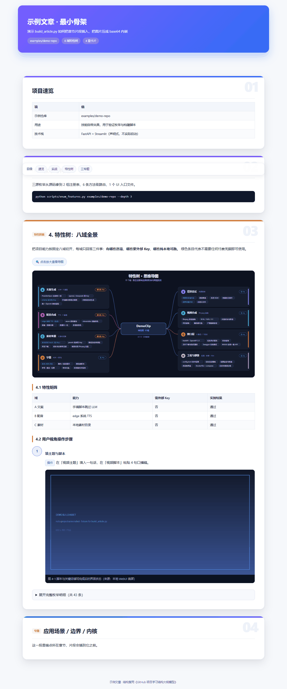
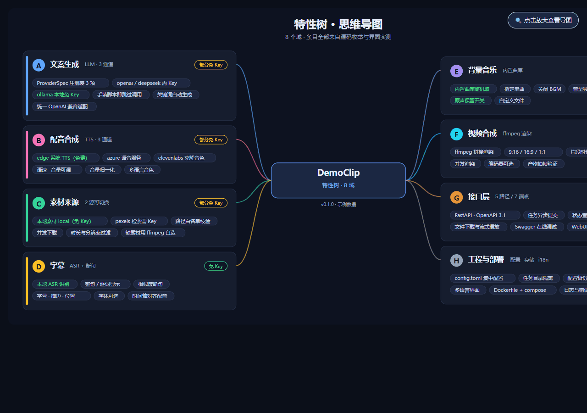

# 例子：从夹具项目到成品 HTML

一条命令一路跑到底，全程约 30 秒。所有输出都是真实执行结果（Windows 11 · Python 3.13 · Pillow 已装）。

```
examples/
├── demo-repo/               夹具项目：假装成一个短视频生成服务
├── mindmap.sample.json      特性树数据（八域）
├── mindmap.sample.svg       导图产物（1800×862）
├── article.main.html        最小主 HTML 骨架（4 个 section）
├── article.section.html     PPT 卡片章节片段（含 IMG_A 占位符）
├── article.out.html         构建产物（37 KB，双击可看）
├── expected-enum.md         枚举产物（下文第 1 步的真实输出）
└── assets/
    ├── demo-shot.png        构建流水线用的演示素材（不是项目截图）
    ├── render-full.png      渲染结果整页
    └── render-zoom.png      导图放大状态
```

---

## 0 前置

```bash
cd github-project-deep-study
python -c "import PIL, playwright; print('deps ok')"
```

缺 Pillow 时 `build_article.py` 会退化成原图内嵌（体积大但能用）；缺 playwright 时跳过渲染自检。

---

## 1 三源枚举

```bash
python scripts/enum_features.py examples/demo-repo --depth 3 --out examples/expected-enum.md
```

真实输出（节选）：

```markdown
# 特性枚举 · demo-repo

## 1. 目录结构（深度 3）
demo-repo/
├── app/
│   ├── services/
│   │   ├── llm_provider.py
│   │   └── tts.py
│   ├── webui/
│   │   └── ui.py
│   └── main.py
├── config.example.toml
└── README.md

## 2. 服务 / 模块层
**app/services/** — 2 个模块

## 3. 注册表 / Provider 声明（可插拔点）
**ProviderSpec** — 3 项：deepseek / ollama / openai
**TTSSpec**      — 3 项：azure / edge / elevenlabs

## 4. 源码中的路由声明
| 方法 | 路径 | 文件 |
|---|---|---|
| GET  | `/api/v1/download/{task_id}` | `app\main.py` |
| HEAD | `/api/v1/download/{task_id}` | `app\main.py` |
| GET  | `/api/v1/ping`               | `app\main.py` |
| POST | `/api/v1/task`               | `app\main.py` |
| GET  | `/api/v1/task/{task_id}`     | `app\main.py` |
| HEAD | `/api/v1/task/{task_id}`     | `app\main.py` |

## 5. UI 层入口（去浏览器里读控件标签）
app\webui\ui.py
```

要看什么：

- **5 条路径 / 6 个方法级端点** —— 计数口径不同，写文章时得说明
- `add_api_route(..., methods=["GET","HEAD"])` 被正确展开成两条
- 注册表按**类名前缀**分组，同一正则能吃到不同的 `XxxSpec`

线上服务起来后加 `--api http://127.0.0.1:8080`，会多出「运行时接口清单」一节（来自 `/openapi.json`，比源码扫描更权威）。

---

## 2 生成特性树导图

```bash
python scripts/gen_mindmap.py --data examples/mindmap.sample.json --out examples/mindmap.sample.svg
```

真实输出：

```
[ok] examples/mindmap.sample.svg | 1800x862 | domains=8 | chars=22232 | theme=dark
```

换浅色主题：`--theme light`；域数多于 8 个时用 `--cols` 控制单列卡片数。

数据格式（`mindmap.sample.json`）：

```json
{
  "title": "特性树 · 思维导图",
  "subtitle": "8 个域 · 条目全部来自源码枚举与界面实测",
  "center": {"title": "DemoClip", "sub": "特性树 · 8 域", "foot": "v0.1.0 · 示例数据"},
  "domains": [
    {"letter": "A", "name": "文案生成", "sub": "LLM · 3 通道",
     "needkey": "部分免 Key", "color": "#60a5fa",
     "children": ["ProviderSpec 注册表 3 项", "ollama 本地免 Key"]}
  ]
}
```

`needkey` 三档决定徽章颜色（免 Key 绿 / 部分免 Key 黄 / 需 Key 红），子条目里含「免费 / 本地 / 内置」的自动绿字高亮 —— 一眼能看出免费通道在哪。

---

## 3 拼装单文件 HTML

先把导图内联进章节片段（替换占位 `<svg>`），再走构建脚本：

```bash
cp examples/article.main.html examples/article.out.html
python scripts/build_article.py \
  --main examples/article.out.html \
  --fragment examples/article.section.html \
  --anchor '  <section id="s6">' \
  --image IMG_A=examples/assets/demo-shot.png
```

真实输出：

```
[insert] fragment 已插入（锚点前），+23659 字符
[image] IMG_A <- demo-shot.png  (7KB -> 4KB)

=== 自检 ===
  doctype         True
  ends_html       True
  sections        4
  h2              4
  h3              2
  tables          2
  data_uris       1
  no_placeholder  True
  size_kb         37
  delta_kb        30.7

RESULT: PASS
```

3 件事都做完了：章节按锚点插入 → PNG 量化到 192 色（7KB→4KB）→ base64 内嵌。

`sections` 用正则 `len(re.findall(r"<section[\s>]", h))` 统计 —— 早期版本写成 `h.count("<section>")`，遇到 `<section id="s1">` 会数成 0，自检形同虚设。

---

## 4 渲染自检

```python
import asyncio
from playwright.async_api import async_playwright

EDGE = r"C:\Program Files (x86)\Microsoft\Edge\Application\msedge.exe"
URL = "file:///.../examples/article.out.html"

async def main():
    async with async_playwright() as p:
        b = await p.chromium.launch(headless=True, executable_path=EDGE, args=["--no-sandbox"])
        pg = await b.new_page(viewport={"width": 1280, "height": 900})
        await pg.goto(URL, wait_until="load")

        bad = await pg.evaluate(
            "() => [...document.images].filter(i=>!i.complete||!i.naturalWidth).length")
        secs = await pg.evaluate("() => document.querySelectorAll('section').length")

        await pg.click("label.mmzoom-l")                       # 点开放大
        await pg.wait_for_timeout(300)
        pos = await pg.evaluate(
            "() => getComputedStyle(document.querySelector('.mindmap-wrap')).position")
        w = await pg.evaluate(
            "() => document.querySelector('.mindmap-wrap').getBoundingClientRect().width")

        await pg.click("label.mmzoom-l")                       # 点合还原
        await pg.wait_for_timeout(300)
        pos2 = await pg.evaluate(
            "() => getComputedStyle(document.querySelector('.mindmap-wrap')).position")

        print(f"images={1} broken={bad} sections={secs}")
        print(f"zoom_open position={pos} width={w:.0f}")
        print(f"zoom_close position={pos2}")
        await b.close()

asyncio.run(main())
```

真实输出：

```
images=1 broken=0 sections=4
zoom_open position=fixed width=1280
zoom_close position=relative
```

三条都过才算交付：图片真的解出来了、章节数对、导图放大**开合都验过**（只截首屏不算验）。

---

## 5 检查产物

`examples/article.out.html` 双击打开应看到：封面渐变 → 吸顶目录 → 4 张编号卡片（01–04）→ 导图可点开放大 → 表格 / 操作步骤 / 折叠明细。





---

## 常见断言失败

| 现象 | 原因 | 处置 |
|---|---|---|
| `[error] 锚点未命中` | 主 HTML 里没有该字符串（含缩进） | 锚点带前导空格，或用 `\n` 表示换行 |
| `no_placeholder False` | `IMG_*` 占位符拼错，或漏了 `--image` | 占位符必须全大写 `IMG_A`；漏图就补参数 |
| `RESULT: FAIL` | doctype / `</html>` / 占位符三选一 | 看自检表逐项对 |
| 导图放大无效 | `input` / `label` / `.mindmap-wrap` 不是同级相邻 | 三者必须相邻，`~` 只认兄弟节点 |
| 导图中心节点被压 | 卡片边界没让开中心节点宽度 | 已修：`left_edge = CX - cw/2 - gap` |
| chip 文字溢出边框 | 中文字宽估算偏小 | 已修：CJK 按 1.06em，padding 26 |
